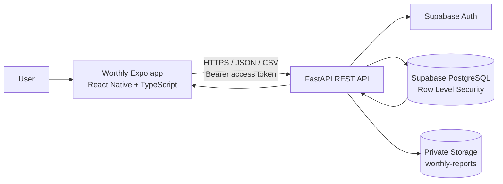
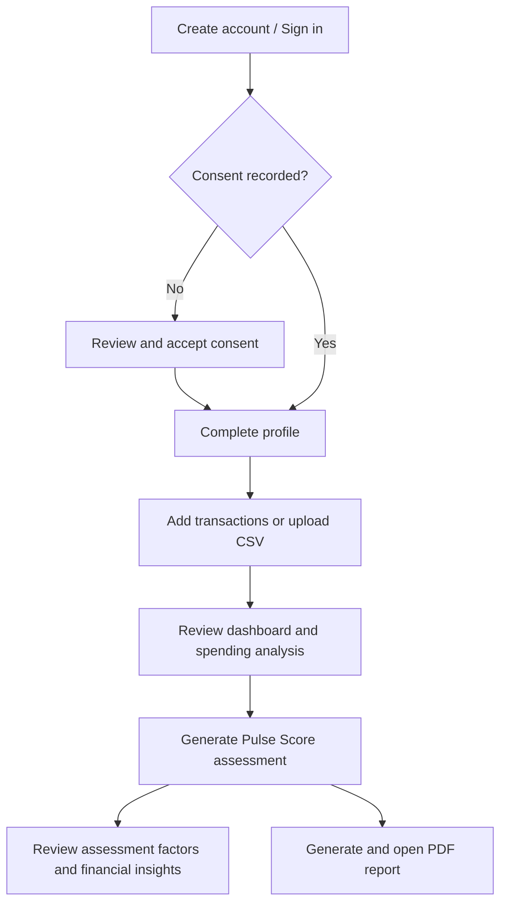

<p align="center">
  
</p>

<h1 align="center">Worthly</h1>

<p align="center"><strong>A clearer view of your financial health.</strong><br />A financial wellness prototype that turns consented transaction history into an understandable overview and an experimental Pulse Score.</p>

<p align="center">
  <a href="https://docs.expo.dev/versions/v58.0.0/"></a>
  <a href="https://reactnative.dev/"></a>
  <a href="https://www.typescriptlang.org/"></a>
  <a href="https://fastapi.tiangolo.com/"></a>
  <a href="https://supabase.com/docs"></a>
  
</p>

> **Prototype notice:** Worthly's Pulse Score is an experimental financial wellness indicator. It is not a bureau credit score, loan approval, or a validated prediction of repayment.

## Contents

- [What Worthly does](#what-worthly-does)
- [Features](#features)
- [How it works](#how-it-works)
- [Technology](#technology)
- [Repository layout](#repository-layout)
- [Get started](#get-started)
- [Supabase setup](#supabase-setup)
- [API reference](#api-reference)
- [Transaction data format](#transaction-data-format)
- [Pulse Score methodology](#pulse-score-methodology)
- [Run the demo](#run-the-demo)
- [Security and privacy](#security-and-privacy)
- [Current scope and future work](#current-scope-and-future-work)
- [Troubleshooting](#troubleshooting)
- [Project topics](#project-topics)

## What Worthly does

Many people have income and regular financial activity but limited formal credit history. Worthly explores how transaction history can help a person understand their own financial patterns and build a clearer financial profile.

The app lets a user record consent, import transaction history, review cash flow and spending, generate a transparent prototype assessment, and create a PDF summary. The project focuses on user understanding and financial inclusion; it does not connect to credit bureaus or make lending decisions.

## Features

| Area | What the prototype supports |
| --- | --- |
| Account | Register, sign in, and retrieve the current authenticated user through FastAPI and Supabase Auth |
| Consent | Require first-use consent and save/retrieve consent records through the API |
| Profile | Save a name, employment type, and monthly income range |
| Transactions | Add a transaction manually or upload a CSV; list the authenticated user's records |
| Financial overview | Summarize income, expenses, net savings, savings ratio, income variation, and category spending |
| Assessment | Calculate a preliminary 0–100 Pulse Score with factor-level explanations |
| Insights | Show readable, transaction-based observations from the analysis response |
| Reports | Generate a PDF from an assessment, store it in a private Supabase Storage bucket, and open it from the app |
| Cross-platform UI | Expo Router app for Android, iOS, and web |

<details>
<summary><strong>Current insights behavior</strong></summary>

The current FastAPI API exposes transaction analysis but does not expose an LLM/AI insights endpoint. The app therefore derives explainable insights from metrics such as savings margin, largest spending category, and month-to-month income variation. The interface does not represent these calculations as AI-generated recommendations.

</details>

## How it works

### Architecture



All authenticated data operations go through FastAPI. The frontend does not query database tables directly. FastAPI validates the access token and uses the authenticated user's JWT for database operations so the Supabase row-level security policies can scope data to that user.

### User journey



### Data lifecycle

1. The user registers or signs in. The app stores the returned access token and attaches it to protected API requests as `Authorization: Bearer <token>`.
2. The app checks consent. New users must record consent before moving on to financial features.
3. Profile and transaction requests go to FastAPI. Protected backend requests derive the owner from the verified token rather than trusting a `user_id` supplied by the app.
4. CSV imports are parsed and validated by FastAPI, then saved as a data source and transactions in Supabase.
5. Analysis and assessment endpoints calculate summaries from the signed-in user's transactions. Assessment factors and the score are stored for history.
6. The report PDF endpoint creates a PDF from the assessment, factors, and transaction summary, stores it in the private bucket, and streams it back to the app.

## Technology

| Layer | Technology | Responsibility |
| --- | --- | --- |
| Mobile/web client | Expo SDK 58, React Native 0.88, TypeScript 6 | Cross-platform screens, forms, CSV selection, navigation, and report preview |
| Navigation | Expo Router | File-based routes and signed-in app navigation |
| API client | Axios | JSON and multipart requests, bearer-token attachment, and error handling |
| Backend | Python, FastAPI, Pydantic | Authentication integration, validation, analysis, assessment, and report generation |
| Authentication | Supabase Auth | Account registration, login, and access tokens |
| Database | Supabase PostgreSQL | Profiles, consents, data sources, transactions, assessments, factors, and reports |
| Authorization | Supabase Row Level Security | Restrict authenticated data access by user |
| Report files | Supabase Storage | Private storage for generated PDFs |

## Repository layout

```text
Worthly/
├── backend/
│   ├── app/
│   │   ├── api/                 # FastAPI routers
│   │   ├── db/                  # Supabase client
│   │   └── services/            # Analysis and assessment calculations
│   └── requirements.txt
├── docs/
│   └── api-contract/            # API contract documentation
├── demo-data/
│   ├── worthly-demo-transactions.csv
│   └── DEMO_RUNBOOK.md
└── frontend/
    └── mobile-app/
        ├── src/app/             # Expo Router screens
        ├── src/components/      # Shared UI components
        ├── src/services/        # API-facing app services
        └── .env.example
```

## Get started

### Prerequisites

- Node.js compatible with Expo SDK 58 (Node.js 22.13 or newer is recommended).
- Python 3.10+ and `pip` for the FastAPI server.
- A Supabase project configured with the tables, RLS policies, and Storage bucket described below.
- A phone/emulator and development computer on a network that can reach the backend, when testing a physical device.

### 1. Configure and run FastAPI

From the repository root:

```powershell
cd backend
py -m venv .venv
.\.venv\Scripts\Activate.ps1
python -m pip install --upgrade pip
pip install -r requirements.txt
```

Create `backend/.env` locally with the backend's Supabase credentials:

```dotenv
SUPABASE_URL=https://YOUR_PROJECT_ID.supabase.co
SUPABASE_KEY=YOUR_SERVER_SIDE_SUPABASE_API_KEY
```

Keep this file private and out of Git. Start the API from the `backend/` directory:

```powershell
uvicorn app.main:app --reload --host 0.0.0.0 --port 8000
```

Useful local endpoints:

- API health: `http://127.0.0.1:8000/health`
- Swagger UI: `http://127.0.0.1:8000/docs`
- OpenAPI JSON: `http://127.0.0.1:8000/openapi.json`

The health route checks connectivity to Supabase. For a phone, use the backend computer's reachable LAN IP in the app configuration, not `127.0.0.1`. Keep both devices on the same network and permit inbound port `8000` on the development machine.

### 2. Configure and run the Expo app

Open a second terminal from the repository root:

```powershell
cd frontend/mobile-app
npm install
Copy-Item .env.example .env.local
```

Edit `frontend/mobile-app/.env.local` and set the backend URL:

```dotenv
EXPO_PUBLIC_API_URL=http://YOUR_BACKEND_LAN_IP:8000/api/v1
```

Start Expo:

```powershell
npx expo start --clear
```

Scan the QR code with Expo Go or use the development server's web option. Restart Expo after changing environment variables. The `.env.example` contains a placeholder only; never put a Supabase service-role or secret key in an `EXPO_PUBLIC_*` variable.

<details>
<summary><strong>Choosing the API host</strong></summary>

| Client | Example base URL |
| --- | --- |
| App running on the backend computer | `http://127.0.0.1:8000/api/v1` |
| Physical phone on the same LAN | `http://192.168.x.x:8000/api/v1` using the backend computer's LAN IP |
| Android Studio emulator | `http://10.0.2.2:8000/api/v1` |

The backend computer must remain online while using its local development server. Deploy the API to a reachable HTTPS host before using the app without that computer.

</details>

### 3. Configure Supabase

The backend expects a Supabase project and tables compatible with its queries. The current repository does **not** include a complete database migration/seed bundle, so verify the database schema and RLS policies with the backend team before running the app.

The backend reads and writes these tables:

- `profiles`
- `consents`
- `data_sources`
- `transactions`
- `assessments`
- `assessment_factors`
- `reports`

Create a **private** Storage bucket named `worthly-reports` and set policies that allow the authenticated report flow to upload and retrieve only the owning user's PDFs. Report generation will fail if the bucket or its policies are missing.

### 4. Test the integration

1. Confirm `/health` reports a healthy database connection.
2. Open `/docs` and verify that the API routes shown below are present.
3. Register a dedicated demo account, accept consent, and finish onboarding.
4. Upload the sample CSV, inspect the dashboard, and generate an assessment.
5. Generate a PDF report and verify that it opens on the device.

## API reference

All routes below are prefixed by `/api/v1`. Protected routes require a valid Supabase access token in the bearer header.

| Method | Endpoint | Purpose |
| --- | --- | --- |
| `POST` | `/auth/register` | Register with email and password |
| `POST` | `/auth/login` | Sign in and receive an access token |
| `GET` | `/auth/me` | Validate/retrieve the current user |
| `GET`, `PUT` | `/profile/` | Retrieve or update profile fields |
| `POST` | `/consents/` | Save consent decision and version |
| `GET` | `/consents/me` | Retrieve the user's consent history |
| `POST` | `/transactions` | Add one transaction |
| `GET` | `/transactions?page=1&limit=100` | List transactions for the current user |
| `POST` | `/transactions/upload/csv` | Validate and import a CSV as `multipart/form-data`, field name `file` |
| `GET` | `/analysis/transactions` | Calculate transaction totals and spending analysis |
| `POST` | `/assessment/generate` | Calculate and persist a Pulse Score assessment |
| `GET` | `/assessment/history` | List assessment history and factors |
| `GET` | `/assessment/{assessment_id}` | Retrieve one assessment and its factors |
| `POST` | `/reports/generate/{assessment_id}` | Create a report metadata record |
| `GET` | `/reports/me` | List report records for the current user |
| `GET` | `/reports/{assessment_id}/pdf` | Generate/store a PDF and return it |
| `GET` | `/reports/{assessment_id}/download` | Download the stored PDF |

The PDF route is the report-generation route used by the app. The `POST /reports/generate/{assessment_id}` route creates metadata only; it does not itself build the PDF.

See the [API contract](docs/api-contract/api-specification.md) or the live Swagger UI for request and response details.

## Transaction data format

The CSV importer expects a header with at least `date`, `description`, and `amount`. The optional columns are `transaction_type` and `category`.

```csv
date,description,amount,transaction_type,category
2026-05-01,Monthly salary,55000.00,credit,Salary
2026-05-05,Apartment rent,18000.00,debit,Housing
```

Importer rules:

- Dates use ISO `YYYY-MM-DD` format.
- Use plain numeric rupee amounts with at most two decimal places; do not include `₹` or thousands separators. The recommended format uses positive amounts with an explicit type.
- CSV `transaction_type` values are `credit` or `debit`. If omitted, the backend infers the type from the sign of the amount, so a negative amount is treated as a debit.
- The API stores amounts as integer paise. Manual entry uses `income` or `expense` and `amount_paise`.
- Files must end in `.csv`, be no larger than 5 MiB, and contain no more than 1,000 rows.
- Uploads **append** transactions. They do not replace or deduplicate previous uploads. The app currently has no clear-history endpoint.
- User ownership comes from the authenticated token; do not add a `user_id` column.

The included [synthetic demo CSV](demo-data/worthly-demo-transactions.csv) has 72 rows across six months (May–October 2026). It contains no real person's financial information. See the [demo runbook](demo-data/DEMO_RUNBOOK.md); use a fresh demo account or upload only once to avoid duplicate rows.

## Pulse Score methodology

The prototype assessment calculates five explainable factors and combines the available factor scores with these weights:

| Factor | Weight | Prototype signal |
| --- | ---: | --- |
| Savings behavior | 30% | Recorded net savings relative to total income |
| Income consistency | 25% | Variation in recorded monthly income; requires income in at least two months |
| Expense management | 20% | Recorded expenses relative to income |
| Cash-flow health | 15% | Share of observed months with positive cash flow |
| Financial history | 10% | Months with transaction history, capped at six months |

The score is calculated from the transaction data and saved as a preliminary assessment with factor explanations and a model version. If a factor lacks enough data, the backend excludes it from the weighted average. This is a hackathon prototype methodology and has not been validated for credit underwriting.

## Run the demo

Use the full [Worthly demo runbook](demo-data/DEMO_RUNBOOK.md) for a pre-demo checklist. Suggested judge walkthrough:

1. Register and show the consent-required onboarding.
2. Upload the synthetic six-month CSV.
3. Show the dashboard's financial summary and spending categories.
4. Generate an assessment and explain the five contributing factors.
5. Refresh the transaction-based financial insights.
6. Generate and open a PDF report.

The profile API currently persists employment type and an income range; it does not persist every exact expense, savings, and debt field shown by the app. The current insights are rule-based analysis, not generated by an LLM. Be transparent about these prototype boundaries during the demo.

## Security and privacy

- Keep `backend/.env` and `frontend/mobile-app/.env.local` out of version control. They are ignored by Git.
- Keep Supabase service-role/secret credentials on a trusted backend only. Expo `EXPO_PUBLIC_*` values are bundled into the client and are not secret.
- Use HTTPS for deployed environments. The LAN HTTP URL is for local development only.
- Send protected API calls through FastAPI; do not access user tables directly from the frontend.
- Verify the backend checks the bearer token and the Supabase RLS policies scope reads/writes to the authenticated user.
- Treat financial data as sensitive. Use synthetic data for demos and do not upload data without authorization.
- Consent records are stored through the API. A full production privacy lifecycle still needs deletion, retention, export, and revocation workflows across database records and stored files.

## Current scope and future work

<details>
<summary><strong>Implemented in this prototype</strong></summary>

- Expo Router frontend with account, consent, profile, dashboard, transaction, assessment, insights, and report screens.
- FastAPI routes for authentication, profile, consent, transaction CSV/manual entry, analysis, assessment history, and reports.
- Supabase Auth integration and user-token-scoped database access.
- Synthetic six-month data for a repeatable demonstration.
- PDF generation and private storage integration, subject to bucket and RLS/Storage policy configuration.

</details>

<details>
<summary><strong>Potential next milestones</strong></summary>

1. Add database migrations and a documented Supabase bootstrap process.
2. Deploy FastAPI to a stable HTTPS environment with managed secrets, monitoring, and backups.
3. Add an authenticated AI insights endpoint on the backend. Keep provider credentials server-side, ground responses in approved user data, validate model output, and retain deterministic insights as a fallback.
4. Expand CSV support with bank-specific templates, preview/confirmation, duplicate detection, and clear error reporting.
5. Complete account data export/deletion, consent revocation, and configurable retention across transactions, assessments, reports, and Storage.
6. Persist the full financial profile if product requirements call for expenses, savings, and obligations.
7. Validate score behavior with representative data, explainability reviews, and fairness/bias evaluation before any credit-related use.
8. Add automated API integration tests, frontend flow tests, and a CI workflow.

</details>

## Troubleshooting

<details>
<summary><strong>Phone cannot reach the API</strong></summary>

Use the backend computer's LAN IP in `.env.local`, confirm both devices are on the same Wi-Fi, allow port `8000` through the backend computer's firewall, and check `/health` from the phone. `127.0.0.1` on a phone points to the phone itself.

</details>

<details>
<summary><strong>Expo web reports a CORS error</strong></summary>

The current FastAPI `main.py` does not install CORS middleware. Browser requests from the Expo web origin (for example `http://localhost:8081`) need the backend to allow that exact development origin. Add `CORSMiddleware` with explicit dev origins in local development and explicit production origins in deployment; avoid wildcard origins when credentials are enabled.

</details>

<details>
<summary><strong>CSV upload returns 4xx</strong></summary>

Check that the selected filename ends in `.csv`, the request uses multipart field `file`, and the header includes `date`, `description`, and `amount`. Follow the date/type/amount rules above. A second upload adds another copy of the rows.

</details>

<details>
<summary><strong>Report generation fails</strong></summary>

Confirm that an assessment exists, the backend `/reports/{assessment_id}/pdf` route is present, and the private `worthly-reports` bucket and policies permit the authenticated report flow to store and retrieve the PDF.

</details>

## Project topics

Suggested GitHub repository topics: `fintech`, `financial-wellness`, `financial-inclusion`, `alternative-credit`, `expo`, `react-native`, `fastapi`, `supabase`, `hackathon`.

---

**By Syntax Squad - Graviton Hackathon 2026**
